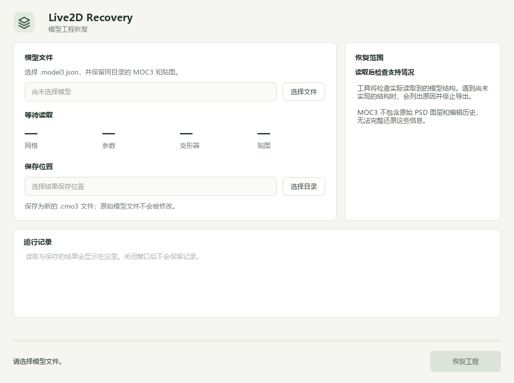

# Live2D Recovery
本工具部分代码由ChatGPT生成
将 Live2D 运行时模型资源恢复为可编辑工程的 Windows 工具。
选择 `.model3.json`，程序读取对应的 MOC3、贴图和附属配置，生成 `.cmo3` 文件。

二进制解析、模型恢复和工程写出均由本项目重新实现，不调用第三方转换器。
Qt 用于窗口、图像、压缩和 XML 等通用功能。实现来源及其边界见 [ORIGIN.md](ORIGIN.md)。

## 支持范围

当前读取 MOC3 内部格式 5、小端序布局；输出工程按 Cubism Editor 5.3 验证。
恢复内容包括网格、贴图、遮罩、参数、部件、曲面与旋转变形器、普通关键形、Blend Shape 及约束、颜色、Glue、已支持的物理设置和参数显示分组。

遇到未验证的布局、部件关键形、复杂绘制分组或其他无法可靠表达的数据时会停止导出。
物理配置目前支持标准重力、无风和 Angle 输出；显示信息支持同组相邻的双参数组合。
UserData、MotionSync 暂不转换；动作、表情和 Pose 保留为原来的独立资源。

运行时资源没有保存的原始 PSD 分层、图层关联和编辑历史无法重新获得。
恢复得到的贴图图像来自纹理图集，不代表找回了原始绘图工程。使用自己拥有或获准处理的模型。

## 使用

从 [Windows 便携版](https://github.com/qmyx/live2d-recovery/releases/tag/windows) 下载程序包，完整解压后双击 `Live2DRecovery.exe`。



1. 选择模型目录中的 `.model3.json`，保持它与 MOC3、贴图的目录关系。
2. 等待读取完成，查看网格、参数、变形器数量和“恢复范围”中的说明。
3. 选择保存目录，点击“恢复工程”。已有结果不会被替换，重名时会另建文件。
4. 在 Cubism Editor 中打开生成的 `.cmo3`，检查默认姿态、参数动作和贴图显示。

如果模型包含尚未支持的结构，界面会列出原因并禁用恢复。运行记录只在当前窗口中保留，程序不保存输入历史。

命令行检查和转换：

```powershell
.\recovery-cli.exe --inspect "D:\Models\example.model3.json"
.\recovery-cli.exe "D:\Models\example.model3.json" "D:\Recovered\example.cmo3"
```

`--inspect` 输出 JSON 概况；`canExport` 表示当前读取结果是否包含已知未支持项。命令行转换要求输出目录已存在，目标文件已存在时会报错。

## 开发

需要 Windows x64、Visual Studio C++、CMake 和 Qt Core/Gui/Widgets。

```powershell
cmake -S . -B build -G "Visual Studio 17 2022" -A x64 -DCMAKE_PREFIX_PATH="你的 Qt 安装目录"
cmake --build build --config Release
```

可选的回归测试只使用程序生成的小模型，另需 Python 3：

```powershell
cmake -S . -B build -DRECOVERY_BUILD_TESTS=ON
cmake --build build --config Release
ctest --test-dir build -C Release --output-on-failure
```

`recovery-cli` 提供输入检查和转换入口，`Live2DRecovery` 为桌面入口。
恢复后的工程仍无法包含运行时资源中没有保存的原始 PSD 关联和编辑历史。

便携程序包使用 `tools/package.ps1` 整理运行库，直接运行生成目录中的 EXE，不需要启动脚本。
传入 Qt 目录、Release 二进制目录、匹配的 x64 Visual C++ 运行库目录和一个尚不存在的输出目录。

## 来源

实现边界、通用依赖和参考材料的使用范围见 [ORIGIN.md](ORIGIN.md)。
关键形与坐标单位的处理规则见 [格式与恢复规则](docs/format-notes.md)。
原创源码使用 [MIT](LICENSE)；Qt 和运行库的许可见 [THIRD_PARTY.md](THIRD_PARTY.md)。
用户模型与测试输出不属于程序源码，不得提交或分发。程序不联网、不上传文件，也不保存输入历史。

程序图标由本项目使用几何线条绘制，没有使用模型素材。图标生成源码位于 `tools/make_icon.cpp`，Windows 资源中没有产品版本字段。

验证方法见 [testing.md](docs/testing.md)。官方 Core 和 Editor 仅用于本地对照，不包含在程序中；
API 加载、数值比较和保存重载检查不能替代在编辑器界面中检查模型的全部表现。
